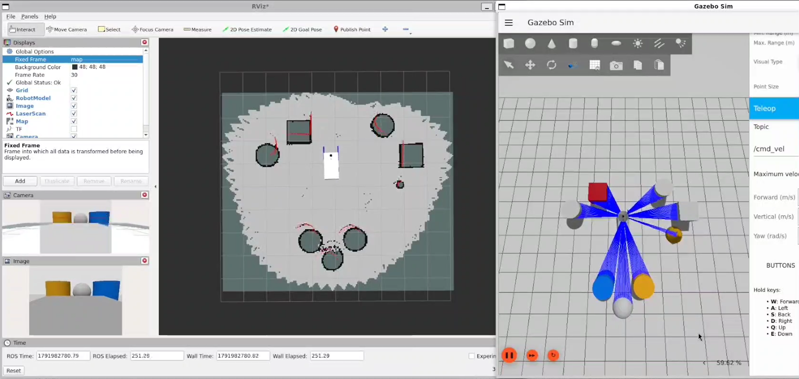

# Autonomous Wheelchair
**CCNY Senior Design Project Fall25-Spring26**

A ROS 2-based autonomous wheelchair navigation and simulation project built with Gazebo, RViz, SLAM Toolbox, and Nav2.
Featuring 2D/3D sensor integration, SLAM mapping, and Nav2 autonomous navigation.

Built for **ROS 2 Jazzy Jalisco** and **Gazebo Harmonic** (`gz-sim`).

---

## 📽️ Demos & Visualizations

### Simulation Overview (Gazebo & RViz)
<!-- Replace the link below with your image or GIF -->
<p align="center">
  
</p>

### SLAM & Autonomous Navigation
| Mapping with SLAM Toolbox | Autonomous Navigation (Nav2) |
| :---: | :---: |
|  |  |

> **Note:** Video demo can be found in the [`docs/`](docs/) folder.

---

## 🚀 Key Features

- **Custom Robot Model:** Wheelchair URDF/Xacro modeling with physical parameters and sensor attachments.
- **Gazebo Simulation:** Custom world environment and differential drive controller integration.
- **Mapping (SLAM):** Real-time 2D occupancy grid generation using `slam_toolbox`.
- **Autonomous Navigation:** Path planning, obstacle avoidance, and costmap management using the `nav2` stack.

---

## 🛠️ Prerequisites & Installation

### Dependencies
Ensure you have the following installed on your system (Assumed ROS 2 Jazzy is already installed):

```bash
sudo apt update && sudo apt install -y \
  ros-jazzy-ros-gz \
  ros-jazzy-gz-ros2-control \
  ros-$ROS_DISTRO-slam-toolbox \
  ros-$ROS_DISTRO-navigation2 \
  ros-$ROS_DISTRO-nav2-bringup \
  ros-$ROS_DISTRO-gazebo-ros-pkgs \
  ros-jazzy-twist-mux \
  ros-jazzy-twist-stamper \
  ros-jazzy-ros2-control \
  ros-jazzy-ros2-controllers\
  ros-jazzy-teleop-twist-keyboard
```

### Build Workspace
Clone the repository into your ROS 2 workspace `src` directory and build:

```bash
# Navigate to your workspace
cd ~/ros2_ws/src

# Clone the repository
git clone https://github.com/ylhuongz/wheelchair_two.git

# Build the package
cd ~/ros2_ws
colcon build --symlink-install
source install/setup.bash
```

---

## 💻 Running the Simulation

Run the following commands in **separate terminal windows** (ensure `source install/setup.bash` is run in each terminal before executing):

### 1. Launch Gazebo Simulation
Starts the wheelchair model inside the Gazebo simulation environment:
```bash
ros2 launch wheelchair_two launch_sim.launch.py
```
**Note:** Once Gazebo is up and running, click on the 3-dot in the top right corner. Search and add "Visualize lidar" (click refresh, topic should be /scan) as well as "teleop" (for movement).

Sometimes the visuals can fail but it's still functional in RViz.

Place some blocks around to create a simulated world.

### 2. Launch RViz
Launches the visualization tool to monitor robot sensors, transforms, and plans:
```bash
rviz2
```
**Note:** Make sure that *Fixed Frame* is set to odom

Use the "Add" button to add the following:

  RobotModel (change *description topic* to "/robot_description")

  LaserScan (change *topic* to "/scan" and *size* to "0.04")

  Camera (change *topic* to "/rgbd_camera/image")

  Image (change *topic* to "/rgbd_camera/image")

### 3. Launch SLAM (Mapping)
Runs the online asynchronous SLAM node to build an occupancy grid map:
```bash
ros2 launch slam_toolbox online_async_launch.py params_file:=./src/wheelchair_two/config/mapper_params_online_async.yaml use_sim_time:=true
```
**Note:** Change *Fixed Frame* to "Map"
Use the "Add" button to add Map (change *topic* to /map)

It might take a few seconds to load. Once loaded, drive the robot around a bit to generate the map before launching Nav2.

### 4. Launch Nav2 (Autonomous Navigation)
Initializes navigation nodes and path planning costmaps:
```bash
ros2 launch nav2_bringup navigation_launch.py params_file:=./src/wheelchair_two/config/nav2_params.yaml use_sim_time:=true
```
**Note:** In the Map display on RViz, there should be more options under topic now. Also, the *Color Scheme* can be changed between "map" and "costmap".

For global costmap, *Fixed Frame* set to "Map"

For local costmap, *Fixed Frame* set to "Odom"

---

## 🙏 Acknowledgements & Credits

This project builds upon the foundational tutorials, architecture, and code provided by:
* **Josh Newans** ([@joshnewans](https://github.com/joshnewans)) and the **[Articulated Robotics](https://www.youtube.com/@ArticulatedRobotics)** YouTube channel.
* The original repository template: [articubot_one](https://github.com/joshnewans/articubot_one).
